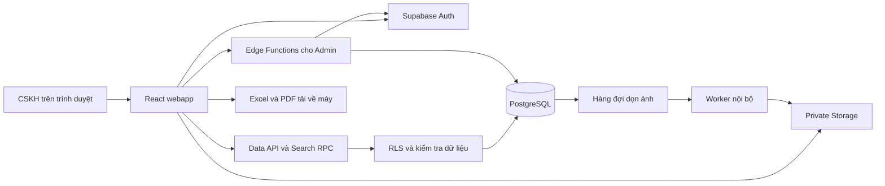

# Kế hoạch xây dựng webapp quản lý ticket CSKH

Ngày lập: 12/09/2026. Phiên bản: 1.0.

Đơn vị sử dụng: Phòng Chăm sóc khách hàng — Công ty Cổ phần Chứng khoán Sài Gòn Hà Nội (SHS).

Tài liệu này là kế hoạch triển khai. Mẫu giao diện đã được chọn; các quyết định kỹ thuật và giá trị mặc định bên dưới là đề xuất triển khai, chưa phải chức năng đã được xây dựng hoặc số liệu hiệu năng đã đo.

## 1. Mục tiêu và phạm vi đã chốt

CSKH sử dụng ứng dụng để ghi nhận, cập nhật, tìm kiếm và quản lý ticket trong quá trình trao đổi với TVĐT và các bộ phận. Các đối tượng khác có thể được cấp role Chỉ xem để tra cứu kho thông tin dùng chung. Thông tin phòng ban và nhân sự xử lý là danh mục để CSKH chọn, độc lập với tài khoản đăng nhập.

Luồng chính: tiếp nhận thông tin → tạo ticket → cập nhật nội dung từ các bên → CSKH đổi trạng thái → tra cứu lại ticket đã xử lý.

Các yêu cầu đã chốt:

- Có đăng nhập, quản lý tài khoản và khôi phục mật khẩu; dùng Supabase cho dữ liệu và lưu ảnh.
- Ba vai trò Admin, User và Chỉ xem (`viewer`). Admin có mọi quyền làm việc với ticket, thêm quyền quản lý tài khoản và xóa danh mục. Chỉ xem được đọc/tra cứu/xuất file, không được thay đổi dữ liệu nghiệp vụ.
- User được tạo, xem, sửa, xóa mọi ticket trong kho dùng chung.
- CSKH tự quản lý danh mục phòng ban, nhân sự, phân mục và hệ thống trong phạm vi quyền được cấp.
- Bốn trạng thái: Tiếp nhận / Đang xử lý / Đã xử lý / Đã hủy.
- CSKH quyết định trạng thái; không có bước xác nhận từ phòng ban hay người xử lý bên ngoài.
- Ticket Đã xử lý chính là thư viện tham khảo. Thư viện đọc dữ liệu trực tiếp từ ticket.
- Tìm kiếm nhanh theo tiêu đề, mô tả và kết quả; hỗ trợ lọc và xuất Excel; mỗi ticket xuất được PDF có thiết kế.
- Xóa ticket phải xử lý cả ảnh tương ứng; phân mục có ticket tham chiếu không được xóa.
- Giao diện theo mẫu Tinh gọn đã chọn: màu cam, light mode mặc định, có chuyển dark mode, chữ và thao tác dễ đọc/dễ dùng.

Phạm vi v1 không bao gồm phân công nhân viên CSKH, chia ca, SLA, KPI, xác nhận liên phòng ban, chat trong ứng dụng, tích hợp/đọc tự động Zalo, AI trả lời, kho bài viết độc lập hoặc quy trình duyệt kiến thức. Đây là giới hạn phạm vi theo cuộc trao đổi, không phải chức năng cần xây thêm để ứng dụng hoạt động.

## 2. Các mặc định để có thể bắt đầu triển khai

| Quyết định | Mặc định trong plan | Lý do |
|---|---|---|
| Đăng nhập | Email công ty và mật khẩu; Admin cấp tài khoản | Có địa chỉ nhận thư khôi phục, không cần đăng ký công khai |
| Kho ticket | Dùng chung cho tài khoản CSKH còn hoạt động | Đúng cách làm việc đã chốt |
| Phân mục | Danh sách phẳng, không giới hạn số lượng ở tầng ứng dụng | Đủ cho yêu cầu hiện tại; danh sách dài có tìm kiếm/phân trang |
| Quan hệ ticket | Một phân mục, một hệ thống, một phòng ban, một nhân sự xử lý; được để trống khi chưa xác định | Đúng cấu trúc thuộc tính đã mô tả, nhập nhanh |
| Trường bắt buộc | Tiêu đề, mô tả, thời điểm tiếp nhận; thời điểm tiếp nhận mặc định hiện tại | Thông tin bên xử lý có thể bổ sung sau |
| Kết quả xử lý | Nhập văn bản nhiều dòng; không chặn thao tác chuyển trạng thái nếu còn trống | CSKH chủ động quyết định hoàn thành |
| Bớt tài khoản | Admin khóa tài khoản; giữ thông tin người tạo trong dữ liệu cũ | Loại bỏ quyền sử dụng mà không mất dấu vết dữ liệu |
| Ảnh | Đề xuất tối đa 10 ảnh/ticket, 10 MB/ảnh; PNG, JPEG, WebP | Giá trị cấu hình ban đầu, có thể điều chỉnh |
| Phân trang | Mặc định 25 ticket; cho chọn 50 hoặc 100 | Giữ trang nhẹ và dễ nhìn |
| Múi giờ | Lưu UTC, hiển thị/nhập/xuất theo Asia/Ho_Chi_Minh | Thống nhất thời gian trên màn hình và báo cáo |
| Loại vấn đề | V1 dùng phân mục do CSKH tự tạo để phân loại | Chưa có định nghĩa riêng cho trường “phân loại”; không tự thêm một hệ phân loại trùng lặp |

Các mặc định trên được ghi rõ để dễ sửa trong quá trình review; không cần mở thêm một vòng hỏi đáp trước khi chuẩn bị triển khai. Một ticket liên quan nhiều hệ thống có thể mô tả các hệ thống còn lại trong nội dung; quan hệ nhiều hệ thống chỉ bổ sung nếu sau này có nhu cầu cụ thể.

## 3. Kiến trúc đề xuất

### 3.1. Công nghệ và trách nhiệm

| Thành phần | Lựa chọn | Vai trò |
|---|---|---|
| Frontend | React + TypeScript + Vite | Ứng dụng nội bộ dạng SPA, build thành tài nguyên tĩnh |
| Giao diện | Tailwind CSS + shadcn/ui tùy biến theo DESIGN.md | Các thành phần nhất quán, form/dialog/dropdown dùng được bằng bàn phím |
| Điều hướng | React Router | Các trang ticket, thư viện, danh mục, tài khoản |
| Dữ liệu phía trình duyệt | TanStack Query | Cache ngắn, trạng thái tải/lỗi, cập nhật lại sau khi lưu |
| Form | React Hook Form + Zod | Form dễ quản lý, kiểm tra trường nhập; backend vẫn kiểm tra lại |
| Auth và database | Supabase Auth + PostgreSQL | Đăng nhập, hồ sơ tài khoản, dữ liệu ticket, RLS |
| File | Supabase Storage, bucket riêng tư | Ảnh ticket có kiểm soát quyền |
| Thao tác đặc quyền | Supabase Edge Functions | Tạo/khóa tài khoản, reset do Admin, thay đổi vai trò |
| Truy vấn tìm kiếm | PostgreSQL RPC chạy theo quyền người gọi | Tìm kiếm, lọc, phân trang, xếp hạng kết quả |
| Excel | ExcelJS, tải thư viện khi cần | Tạo XLSX có định dạng ở trình duyệt, tác vụ lớn chạy trong Web Worker |
| PDF | pdf-lib + fontkit, tải thư viện khi cần | PDF A4 tiếng Việt, phân trang thủ công và phụ lục ảnh |
| Kiểm thử | Vitest, Playwright và kiểm thử database/RLS | Quy tắc dữ liệu, các luồng chính, quyền truy cập và hiệu năng |

Chọn Vite vì sản phẩm chủ yếu là các màn hình sau đăng nhập và CRUD/tìm kiếm. Quyền đặc biệt được xử lý ở Edge Functions, nên không cần duy trì thêm một máy chủ web chạy liên tục chỉ để phục vụ giao diện. Vite hỗ trợ build tài nguyên tĩnh; shadcn/ui cung cấp mã component để tùy biến. [Vite](https://vite.dev/guide/) · [shadcn/ui](https://ui.shadcn.com/docs)

Phiên bản package sẽ được chọn theo bản stable tương thích tại thời điểm khởi tạo, khóa trong lockfile. Không dùng một bộ giao diện thứ hai song song với shadcn/ui.

### 3.2. Đường đi của dữ liệu



Frontend chỉ chứa URL và publishable key của Supabase. Secret/service-role key chỉ nằm trong môi trường máy chủ. Edge Function phải xác thực người gọi và kiểm tra quyền Admin hiện tại trước thao tác đặc quyền; không tin vai trò do trình duyệt gửi lên. [Bảo vệ Edge Functions](https://supabase.com/docs/guides/functions/auth)

### 3.3. Cấu trúc mã dự kiến

```text
public/                      Logo gốc và tài nguyên công khai
src/app/                     Router, providers, theme, app shell
src/components/ui/           Component dùng chung
src/features/auth/           Đăng nhập, mật khẩu, phiên làm việc
src/features/tickets/        Danh sách, chi tiết, form, ảnh
src/features/library/        Tra cứu các ticket đã xử lý
src/features/catalogs/       Phân mục, hệ thống, phòng ban, nhân sự
src/features/users/          Quản lý tài khoản Admin
src/features/exports/        Excel, PDF, Web Worker
src/lib/                     Supabase client, thời gian, kiểu dữ liệu
supabase/migrations/         Schema, ràng buộc, RLS, chỉ mục, RPC
supabase/functions/          Admin API và worker dọn file
supabase/tests/              Test quyền và quy tắc dữ liệu
tests/e2e/                   Các luồng sử dụng chính
docs/                        Tài liệu vận hành, nghiệm thu, benchmark
```

## 4. Phân quyền

| Thao tác | Chỉ xem | User | Admin |
|---|:---:|:---:|:---:|
| Đăng nhập, đổi/khôi phục mật khẩu bản thân | Có | Có | Có |
| Xem/tìm kiếm mọi ticket và thư viện | Có | Có | Có |
| Tạo, sửa, đổi trạng thái, xóa ticket | Không | Có | Có |
| Xem ảnh của ticket | Có | Có | Có |
| Thêm/xóa ảnh của ticket | Không | Có | Có |
| Xuất Excel và PDF trong dữ liệu được phép xem | Có | Có | Có |
| Xem các danh mục | Có | Có | Có |
| Tạo/sửa phân mục, phòng ban, nhân sự xử lý | Không | Có | Có |
| Tạo/sửa hệ thống liên quan | Không | Không | Có |
| Xóa phân mục/hệ thống/phòng ban/nhân sự | Không | Không | Có, nếu không còn tham chiếu |
| Danh sách tài khoản, tạo, khóa/mở khóa, đổi vai trò | Không | Không | Có |
| Reset mật khẩu cho thành viên | Không | Không | Có |

Quyền tạo/sửa hệ thống được giữ cho Admin theo yêu cầu ban đầu “Admin có thể tạo thêm”. Quyền tạo/sửa các danh mục còn lại là mặc định đề xuất để CSKH chủ động quản lý; User không được xóa danh mục.

Hệ thống kiểm tra quyền ở database/Edge Functions. Ẩn nút trên giao diện chỉ nhằm giúp dễ dùng. Không được thay đổi vai trò hoặc trạng thái hoạt động bằng cách sửa hồ sơ của chính mình. Ngăn thao tác khóa/hạ quyền Admin cuối cùng, kể cả hai yêu cầu đồng thời.

## 5. Thiết kế dữ liệu

### 5.1. Các bảng nghiệp vụ

| Bảng | Trường chính và quy tắc |
|---|---|
| `app_users` | `id` trùng Auth user ID; `full_name`, `department_id`, `role`, `is_active`, `created_at`, `created_by`. Email đăng nhập do Auth quản lý. Hồ sơ được cấp quyền ghi qua luồng Admin. |
| `categories` | `id`, `name`, `created_at`, `created_by`, `updated_at`. Tên được trim, tránh trùng khi chỉ khác hoa/thường. Không giới hạn số lượng do ứng dụng áp đặt. |
| `systems` | `id`, `name`, `created_at`, `created_by`, `updated_at`. Các hệ thống do Admin tạo. |
| `departments` | `id`, `name`, `created_at`, `created_by`, `updated_at`. Có thể được tham chiếu bởi tài khoản, nhân sự và ticket. |
| `staff` | `id`, `full_name`, `department_id`, `created_at`, `created_by`, `updated_at`. Nhân sự này không cần tài khoản ứng dụng. Tên người có thể trùng. |
| `tickets` | Các trường trong bảng chi tiết bên dưới. |
| `ticket_attachments` | `id`, `ticket_id`, `storage_path`, `original_name`, `mime_type`, `size_bytes`, `width`, `height`, `sort_order`, `upload_status`, `created_at`, `created_by`. |

Thêm bảng kỹ thuật `private.storage_gc_jobs` để theo dõi file cần xóa, số lần thử, lần thử tiếp theo và lỗi gần nhất. Bảng này không xuất hiện như một phân hệ nghiệp vụ của CSKH và không cho client đọc/ghi trực tiếp.

### 5.2. Bảng ticket

| Trường | Kiểu/nguồn | Quy tắc |
|---|---|---|
| `id` | UUID do server sinh | Khóa nội bộ |
| `ticket_no` | Sequence/bigint do server sinh | Hiển thị dạng `CSKH-000123`; duy nhất, không tái sử dụng, có thể có khoảng trống số |
| `created_at` | timestamptz, server | Ngày giờ tạo bản ghi |
| `received_at` | timestamptz, CSKH nhập | Ngày giờ thực tế tiếp nhận; mặc định hiện tại, được chỉnh |
| `title` | text | Bắt buộc; đề xuất tối đa 200 ký tự |
| `description` | text | Bắt buộc; giữ xuống dòng |
| `system_id` | FK systems, nullable | Chưa xác định được phép để trống |
| `category_id` | FK categories, nullable | Được thay đổi sau khi tạo |
| `department_id` | FK departments, nullable | Bộ phận xử lý, không dùng để giới hạn quyền đọc |
| `assigned_staff_id` | FK staff, nullable | Nhân sự thuộc danh mục bên xử lý |
| `resolution` | text, nullable | Nội dung/kết quả xử lý, giữ xuống dòng |
| `status` | enum/check constraint | `received`, `in_progress`, `resolved`, `cancelled` |
| `completed_at` | timestamptz, nullable | Server tự ghi khi CSKH chuyển sang Đã xử lý |
| `created_by`, `updated_by` | FK app_users | Ghi từ phiên đăng nhập, không nhận giá trị tùy ý từ client |
| `updated_at` | timestamptz, server | Cập nhật sau khi lưu |
| `version` | integer, server | Kiểm soát ghi đè khi hai người cùng sửa |
| `search_text` | text, server duy trì | Văn bản chuẩn hóa để tìm không dấu |
| `search_vector` | tsvector, server duy trì | Chỉ mục tìm theo từ và xếp hạng |

Ảnh nằm trong `ticket_attachments`, không nhét danh sách URL vào cột text/JSON của ticket. URL ký tạm không được lưu làm địa chỉ ảnh cố định.

### 5.3. Ràng buộc và vòng đời

- Tạo ticket mặc định Tiếp nhận; người dùng có thể chọn trạng thái phù hợp ngay khi ghi nhận một vấn đề đã giải quyết.
- Khi chuyển từ trạng thái khác sang Đã xử lý: server ghi `completed_at` bằng thời gian hiện tại.
- Sửa nội dung của ticket đang Đã xử lý: giữ nguyên `completed_at`.
- Chuyển từ Đã xử lý sang trạng thái khác: xóa `completed_at`; chuyển lại Đã xử lý thì ghi mốc mới. Đây là quy tắc mặc định cho bản v1, chưa có lịch sử nhiều chu kỳ xử lý.
- Đã hủy không được tính là đã hoàn thành và không xuất hiện trong thư viện.
- Cho đổi phòng ban khi sửa ticket; nếu người đang chọn không thuộc phòng mới thì yêu cầu chọn lại hoặc để trống.
- Backend kiểm tra cặp phòng ban/nhân sự khi tạo hoặc đổi phân công. Nếu nhân sự chuyển phòng trong danh mục sau này, ticket cũ vẫn giữ phòng ban đã ghi nhận; không sửa hàng loạt dữ liệu lịch sử.
- Xóa danh mục được chặn bằng khóa ngoại trong database, không chỉ bằng bộ đếm trên UI. Phòng ban còn nhân sự/tài khoản/ticket cũng không được xóa.
- Đổi tên danh mục cập nhật tên hiển thị trên các ticket đang tham chiếu; không nhân bản dữ liệu tên trong từng ticket.
- Khi lưu, dùng điều kiện `id + version`. Nếu đã có người khác sửa: thông báo và cho tải bản mới; giữ nội dung người dùng đang nhập để sao chép nếu cần.
- Nội dung nhập là văn bản, không thực thi HTML. Không đưa mô tả, ảnh hoặc thông tin khách hàng vào log kỹ thuật.

## 6. Auth và RLS với ưu tiên hiệu năng

### 6.1. Tài khoản và mật khẩu

- Trang đăng nhập bằng email/mật khẩu; email được chuẩn hóa, có hiện/ẩn mật khẩu và lỗi dễ hiểu.
- Tắt đăng ký công khai và anonymous sign-in. Tạo Admin đầu tiên bằng quy trình bootstrap có ghi hướng dẫn.
- Admin tạo tài khoản và gửi đường dẫn thiết lập mật khẩu qua email. Nếu bước tạo Auth thành công nhưng tạo hồ sơ thất bại, xử lý bù và báo lỗi rõ; không để tài khoản mồ côi sử dụng ứng dụng.
- User đổi mật khẩu khi đăng nhập; nếu quên mật khẩu, nhận link khôi phục qua email.
- Admin có nút gửi reset cho một tài khoản; không cần xem mật khẩu hiện tại.
- Link hết hạn hoặc đã dùng có thông báo và đường quay về yêu cầu link mới. Cấu hình đúng redirect cho local, staging và production.
- Dùng SMTP thực tế cho thư tài khoản/khôi phục; cấu hình sender và thử nhận thư vào hộp thư công ty trước bàn giao. [Supabase SMTP](https://supabase.com/docs/guides/auth/auth-smtp)
- Khóa tài khoản chặn các yêu cầu mới tới database, Storage có xác thực và thao tác đặc quyền, kể cả người đó còn giữ token chưa hết hạn. Ngoại lệ với signed URL đã cấp được nêu tại mục 8.2. Đăng xuất hoặc đổi tài khoản phải xóa cache dữ liệu trong ứng dụng.

### 6.2. Thiết kế policy

Tất cả CSKH được xem cùng dữ liệu, nên policy ticket chỉ cần kiểm tra tài khoản hợp lệ còn hoạt động. Không thêm điều kiện người tạo/phòng ban vào quyền đọc ticket.

Mẫu thiết kế: helper `private.is_active_user()` đọc `app_users` theo Auth ID có chỉ mục; helper `private.is_admin()` kiểm tra hoạt động và vai trò Admin. Khi không phụ thuộc từng ticket, gọi dưới dạng scalar subquery để PostgreSQL có thể tính một lần cho câu lệnh. Đây là cách tối ưu cần kiểm chứng bằng query plan, không phải bảo đảm mặc định của mọi truy vấn.

| Tài nguyên | Policy dự kiến |
|---|---|
| Tickets | Active User/Admin: SELECT, INSERT, UPDATE, DELETE toàn bộ kho |
| Categories, departments, staff | Active User/Admin: SELECT/INSERT/UPDATE; DELETE chỉ Admin |
| Systems | Active User/Admin: SELECT; ghi và xóa chỉ Admin |
| App users | Hồ sơ bản thân và dữ liệu tên cần hiển thị; quản lý tài khoản đầy đủ qua Admin API |
| Attachment metadata | Active User/Admin, ticket hợp lệ; đường dẫn và ID được kiểm soát |
| Storage | Bucket private; chỉ thao tác đúng object gắn với ticket/attachment hợp lệ |
| GC jobs | Client không có quyền; trigger/worker nội bộ quản lý |

Helper đặc quyền có `search_path` cố định, tham chiếu schema rõ, phạm vi trả về tối thiểu và quyền execute tường minh; tránh policy tự truy vấn lặp đệ quy trên `app_users`. Không dùng `user_metadata` mà thành viên có thể sửa làm nguồn quyền Admin. Các cột hệ thống được bảo vệ bằng quyền cột/trigger/RPC phù hợp.

**Cập nhật theo phê duyệt khi triển khai:** wrapper Search RPC dùng `SECURITY INVOKER`, gọi lõi `SECURITY DEFINER` hẹp có kiểm tra tài khoản CSKH đang hoạt động trước mọi lượt đọc. Tất cả CSKH hoạt động được đọc chung kho ticket; không nhận danh tính từ tham số và không trả dữ liệu ngoài phạm vi danh sách. RLS giữ nguyên cho các thao tác khác. Quyết định và ranh giới quyền được mô tả trong `docs/OPERATIONS.md`; guard phải được giữ khi tối ưu query. Mọi policy chỉ định role, thao tác và kiểm tra dữ liệu ghi (`WITH CHECK`) phù hợp.

Đo truy vấn với role `authenticated` và claims của User thực, có RLS bật. Kiểm tra chỉ mục, số hàng quét và phần thời gian policy trước khi tối ưu tiếp. [Khuyến nghị hiệu năng RLS](https://supabase.com/docs/guides/database/postgres/row-level-security-performance)

## 7. Tìm kiếm, bộ lọc và thư viện

### 7.1. Hành vi người dùng

- Một ô tìm kiếm chính trên danh sách ticket và thư viện; tìm trong tiêu đề, mô tả, kết quả và mã ticket.
- Có dấu/không dấu và hoa/thường cho cùng kết quả: `đăng nhập`, `dang nhap`, `ĐĂNG NHẬP`.
- Mặc định yêu cầu các từ khóa cùng xuất hiện trong bộ nội dung được tìm; không yêu cầu nằm cùng một trường.
- Ưu tiên mã ticket khớp chính xác, tiếp đến tiêu đề, rồi nội dung/kết quả. Các kết quả ngang mức liên quan sắp theo thời gian và ID để thứ tự ổn định.
- Hỗ trợ tiền tố từ cuối khi đang gõ. Chuỗi 1–2 ký tự được xử lý bằng đường tìm tiền tố thay vì quét substring toàn bảng; đo riêng trường hợp rất nhiều kết quả.
- Debounce đề xuất 250 ms. Hủy/bỏ qua phản hồi của truy vấn cũ; kết quả cũ không được ghi đè truy vấn mới.
- Giữ kết quả hiện tại trong lúc tải lượt mới, hiển thị trạng thái đang tìm vừa đủ; có thông báo khi không có kết quả hoặc mất kết nối.
- Highlight từ khớp và trích đoạn ngắn, không tải toàn bộ nội dung/ảnh của mọi ticket lên danh sách.

### 7.2. Cách lưu và lập chỉ mục

Chuẩn hóa ở database bằng lowercase + bỏ dấu + chuẩn hóa khoảng trắng, kiểm thử riêng `đ/Đ`, Unicode tổ hợp và dấu tiếng Việt. Duy trì `search_text`/`search_vector` khi tiêu đề, mô tả hoặc kết quả thay đổi; không chạy hàm bỏ dấu lên toàn bộ cột ở mỗi lần tìm. Không gắn nhãn IMMUTABLE giả cho hàm chuẩn hóa để ép tạo index. [PostgreSQL unaccent](https://www.postgresql.org/docs/current/unaccent.html)

Thiết kế đầu tiên: full-text search cấu hình `simple`, GIN index trên `search_vector`; ưu tiên trọng số tiêu đề. Trigram index trên `search_text` phục vụ tìm gần đúng/đoạn chuỗi khi đường tìm theo từ không có kết quả phù hợp, tối thiểu 3 ký tự cho đường này. Các truy vấn rất ngắn không khai thác trigram hiệu quả nên cần đường xử lý riêng. [Full-text search](https://supabase.com/docs/guides/database/full-text-search) · [PostgreSQL pg_trgm](https://www.postgresql.org/docs/current/pgtrgm.html)

RPC nhận query và filter dưới dạng tham số; không nối chuỗi SQL từ đầu vào. Chuẩn hóa ký tự đặc biệt trước khi dựng truy vấn từ, tránh lỗi cú pháp với dấu nháy hoặc dấu ngoặc. Trả về số dòng có giới hạn và cursor; chỉ tính xếp hạng trên tập ứng viên phù hợp.

Các chỉ mục ban đầu ngoài chỉ mục tìm kiếm:

- `ticket_no` duy nhất.
- `(received_at DESC, id DESC)` cho danh sách mặc định.
- `(status, received_at DESC, id DESC)` cho các tab trạng thái.
- `(completed_at DESC, id DESC) WHERE status = 'resolved'` cho thư viện.
- Chỉ mục trên FK: category, system, department, assigned_staff và ticket_id của ảnh.
- `app_users.id` và các khóa dùng trong helper quyền.

Chỉ thêm composite index theo tổ hợp filter nếu benchmark cho thấy cần. Đo cả chi phí cập nhật chỉ mục khi sửa ticket; không lập mọi tổ hợp có thể có.

### 7.3. Bộ lọc và thư viện

Filter gồm trạng thái, hệ thống, phân mục, phòng ban, nhân sự và khoảng thời gian. Bộ lọc thời gian cho chọn Ngày tiếp nhận / Ngày tạo / Ngày hoàn thành; mặc định Ngày tiếp nhận. Trạng thái/thời gian phổ biến ở ngoài, filter còn lại trong vùng mở rộng.

Lọc theo ngày bao gồm cả ngày cuối trong múi giờ Việt Nam, quy đổi thành khoảng UTC từ đầu ngày bắt đầu tới trước đầu ngày kế tiếp của ngày kết thúc. Màn hình và Excel dùng chung hàm chuyển đổi để không lệch kết quả ở sát nửa đêm.

Lưu tìm kiếm, filter và sắp xếp trên URL để quay lại từ chi tiết vẫn đúng trạng thái. Dữ liệu danh mục có cache và invalidation sau thay đổi; danh sách dài dùng combobox có tìm kiếm/phân trang.

Danh sách ticket làm mới khi quay lại tab trình duyệt và định kỳ khoảng 30 giây lúc màn hình đang hiển thị để thấy cập nhật của đồng nghiệp. Không tự thay dữ liệu trong form đang sửa. Ngừng polling khi tab ẩn; không cần thêm hệ thống thông báo hay Realtime cho bản đầu.

Thư viện là màn hình chuyên đọc, luôn thêm điều kiện `status = 'resolved'`, sắp ngày hoàn thành mới nhất khi chưa tìm từ khóa. Trích đoạn ưu tiên kết quả xử lý. Chi tiết thể hiện thời điểm tiếp nhận, hoàn thành, mô tả, kết quả, bên xử lý và ảnh để người đọc hiểu bối cảnh. Ticket đổi khỏi Đã xử lý sẽ rời thư viện. Không sao chép ticket sang bảng khác.

## 8. Ảnh và xóa ticket

### 8.1. Luồng thêm ảnh

1. Chọn file, kéo thả hoặc dán ảnh từ clipboard; thấy preview và có thể bỏ từng ảnh.
2. Trước khi lưu ticket mới, file ở tạm trong trình duyệt. Hủy form ở bước này không phát sinh object trên Storage.
3. Lưu ticket, tạo metadata ảnh pending với object path do hệ thống quyết định; bắt đầu upload có giới hạn số file đồng thời.
4. Upload xong, xác nhận metadata ready. UI thể hiện tiến độ từng ảnh và cho thử lại ảnh thất bại, không giả báo tất cả đã lưu.
5. Chỉ ảnh ready hiển thị như đính kèm hoàn chỉnh. Kiểm tra kích thước/loại file ở cả phía client và phía nhận upload.

Object path dùng ticket UUID + attachment UUID + phần mở rộng hợp lệ; không dùng tên người dùng nhập làm đường dẫn. Mỗi ảnh thuộc một ticket, không dùng chung object giữa các ticket. Chuẩn hóa/nén ảnh phải giữ đủ nét để đọc chữ lỗi; giới hạn byte áp dụng cả dữ liệu trước khi giải mã ảnh lớn.

Bucket private, URL xem ảnh có hạn. Khi hết hạn, ứng dụng lấy URL mới sau kiểm tra quyền. Chỉ tải ảnh chi tiết khi cần. Hỗ trợ xem lớn và mở ảnh gốc; không tự cắt nội dung ảnh bằng thumbnail `cover` trong chế độ đọc lỗi.

### 8.2. Xóa và chống file rác

- User bấm Xóa ticket → dialog ghi mã/tiêu đề và nhắc xóa kèm ảnh → xác nhận một lần.
- Trong cùng transaction database, BEFORE DELETE trigger ghi các storage path cần xóa vào `private.storage_gc_jobs`, sau đó xóa ticket và metadata phụ thuộc.
- Worker lấy job và gọi Storage API để xóa file. Lần xóa thất bại được retry có backoff; giữ thông tin đủ để thử lại. Object đã không tồn tại được coi là thành công.
- Xóa từng ảnh cũng đi qua cơ chế ghi job trước khi mất metadata.
- Chạy worker định kỳ; mục tiêu dọn file trong 5 phút khi dịch vụ bình thường. Không mô tả hai hệ thống database/Storage như một transaction nguyên tử.
- Thu hồi quyền xem object khi ticket/attachment không còn tồn tại, kể cả đang chờ worker dọn. Signed URL đã phát hành có thể còn dùng được tới lúc hết hạn hoặc file bị xóa; dùng thời hạn ngắn, không hứa thu hồi tức thì mọi URL đã cấp.
- Có lần đối soát định kỳ với khoảng chờ an toàn để dọn upload dang dở và xử lý race giữa upload/xóa. Không xóa object đang có metadata hợp lệ.
- Job lỗi nhiều lần phải có log/cảnh báo cho vận hành; không được âm thầm bỏ job.

Supabase yêu cầu xóa file qua Storage API; xóa SQL trong bảng metadata của Storage không xóa được object thực. [Tài liệu xóa object](https://supabase.com/docs/guides/storage/management/delete-objects)

## 9. Màn hình và hành vi giao diện

Thiết kế chi tiết ở [DESIGN.md](./DESIGN.md). Logo gốc đã có trong `public`; không dùng chữ/biểu tượng giả thay logo SHS.

| Màn hình | Nội dung và thao tác |
|---|---|
| Đăng nhập | Logo, email, mật khẩu, quên mật khẩu, thông báo lỗi rõ |
| Danh sách ticket | Search nổi bật, Tạo ticket, tab trạng thái, filter, bảng, xuất Excel, phân trang |
| Tạo/sửa ticket | Nhóm nội dung vấn đề; phân loại/bên xử lý; trạng thái/kết quả; khu vực ảnh. Nhãn luôn hiện, giữ dữ liệu khi lưu lỗi |
| Chi tiết ticket | Tiêu đề/mã/trạng thái, các mốc thời gian, nội dung, kết quả, bên xử lý, ảnh; Sửa / Xuất PDF / Xóa |
| Thư viện | Danh sách Đã xử lý; search/filter; đọc bối cảnh và kết quả, chuyển tới ticket gốc |
| Danh mục | Tab Phân mục / Hệ thống / Phòng ban / Nhân sự. Tạo/sửa; xóa theo quyền và ràng buộc |
| Tài khoản | Chỉ Admin: tìm tài khoản, tạo, sửa hồ sơ/vai trò, khóa/mở khóa, gửi reset |
| Tài khoản bản thân | Thông tin đăng nhập, đổi mật khẩu, light/dark, đăng xuất |

Trên desktop, click tiêu đề ticket mở trang chi tiết có URL riêng. Quay lại giữ search/filter/vị trí danh sách. Form tạo/sửa dùng trang đủ rộng để đọc mô tả dài và nhiều ảnh, tránh dialog nhỏ phải cuộn lồng nhau. Các dialog chỉ dành cho thao tác ngắn như xóa hoặc thêm danh mục.

Mọi thao tác lưu có nút tên rõ, trạng thái đang lưu và thông báo kết quả. Không dùng icon đơn độc cho thao tác chính. Mất kết nối hoặc phiên hết hạn không làm biến mất nội dung đang nhập trong phiên trang. Không lưu nội dung ticket nhạy cảm vào localStorage để làm bản nháp mặc định.

## 10. Xuất Excel và PDF

### 10.1. Excel

- Xuất toàn bộ ticket khớp search/filter hiện tại, không chỉ trang đang xem; thông báo rõ phạm vi trước khi tải.
- Cột: mã ticket, ngày tạo, ngày tiếp nhận, tiêu đề, mô tả, hệ thống, phân mục, phòng ban xử lý, nhân sự xử lý, kết quả, trạng thái, ngày hoàn thành, người tạo, số ảnh.
- Sheet Dữ liệu có header, autofilter, freeze hàng đầu, độ rộng cột hợp lý, wrap nội dung và ngày giờ theo Việt Nam. Sheet Điều kiện xuất ghi bộ lọc, thời điểm xuất, số dòng.
- Không nhúng ảnh hoặc URL ký tạm vào Excel. Không ghi nội dung người dùng thành công thức Excel; giá trị bắt đầu bằng `=`, `+`, `-`, `@` vẫn phải là dữ liệu an toàn.
- Truy xuất theo batch với cursor ổn định `(created_at, id)`; deduplicate theo ID và giữ mốc thời gian bắt đầu để không lẫn ticket mới phát sinh giữa lượt xuất. Không dùng trường có thể sửa làm cursor xuất. V1 không cam kết snapshot lịch sử tuyệt đối nếu đồng nghiệp sửa ticket trong lúc xuất.
- Xử lý tạo file trong Worker, có tiến độ và hủy. Không làm nghẽn luồng tìm kiếm UI. Benchmark tối thiểu 10.000 dòng có nội dung dài; nếu phạm vi lớn vượt khả năng bộ nhớ, tách thành các file XLSX có đánh số, không âm thầm cắt dữ liệu.
- Module xuất tải riêng khi bấm dùng. [ExcelJS](https://github.com/exceljs/exceljs)

### 10.2. PDF từng ticket

- Tải trực tiếp PDF A4 dọc. Header có logo Light, tên công ty và “Phiếu ghi nhận và xử lý vấn đề”.
- Khối mã/trạng thái, thời điểm tạo/tiếp nhận/hoàn thành; các nhóm phân mục, hệ thống, phòng ban, nhân sự; mô tả; kết quả; ảnh kèm chú thích.
- Nội dung dài tự xuống trang, không cắt chữ hay ép toàn bộ ticket vào một trang. Footer có số trang và thời điểm xuất.
- PDF luôn dùng nền sáng để in; màu nhận diện dùng tiết chế. Font Unicode nhúng có giấy phép phù hợp, đủ tiếng Việt; thử tên người và câu nhiều dấu.
- PNG/JPEG đưa vào PDF; WebP được chuyển định dạng khi dựng bản in. Giữ tỉ lệ ảnh, có trang phụ lục nếu ảnh dài hoặc nhiều.
- Nếu một ảnh tải lỗi, cho thử lại hoặc chọn xuất thiếu ảnh với thông báo rõ; không âm thầm bỏ ảnh.
- Có thể chọn không đưa ảnh vào bản in để in nhanh; dữ liệu ticket gốc vẫn giữ nguyên.
- Nghiệm thu bằng file thực tế: đọc bằng PDF viewer, trích xuất đủ nội dung và kiểm tra bản render nhiều trang. Bản triển khai dùng pdf-lib, font Noto Sans và tự dàn trang để kiểm soát header/footer.

## 11. Tiêu chí nghiệm thu

### 11.1. Chức năng và quyền

| Nhóm | Tình huống phải kiểm chứng |
|---|---|
| Auth | Đăng nhập, đăng xuất, sai mật khẩu, quên mật khẩu, link hết hạn, thay đổi mật khẩu |
| Admin | Tạo tài khoản, danh sách có phân trang, reset thành viên, khóa/mở, bảo vệ Admin cuối cùng |
| Chặn truy cập | Chưa đăng nhập không đọc được ticket/ảnh; tài khoản khóa bị chặn dù còn token |
| Quyền User | CRUD mọi ticket; thêm/xóa ảnh; không xóa danh mục, không quản lý tài khoản, không tự nâng quyền qua API |
| Ticket | Tạo thiếu dữ liệu, lưu bình thường, sửa phân mục/hệ thống/phòng/người; nội dung dài và tiếng Việt |
| Trạng thái | Bốn trạng thái; ngày hoàn thành tự điền đúng, không thay khi chỉ sửa nội dung, xóa khi mở lại |
| Đồng thời | Hai User sửa cùng ticket; không ghi đè âm thầm |
| Danh mục | Tên trùng, danh sách dài, xóa khi đang có tham chiếu; race tạo ticket/xóa phân mục |
| Ảnh | Upload nhiều ảnh, dán clipboard, ảnh quá lớn/sai định dạng, retry, hủy form, lỗi mạng |
| Xóa file | Xóa ticket/xóa ảnh; Storage lỗi; retry; upload và xóa đồng thời; đối soát không xóa nhầm |
| Tìm kiếm | Có dấu/không dấu, `đ`, query ngắn, mã ticket, từ đặc biệt, kết quả nhiều/không có; tất cả filter |
| Thư viện | Chỉ Đã xử lý; dữ liệu đồng bộ sau sửa và đổi trạng thái; thấy đầy đủ bối cảnh |
| Excel | Xuất vượt một trang, đủ cột, đủ dòng, đúng filter/ngày, nội dung công thức giả được giữ như text |
| PDF | Logo, tiếng Việt, mô tả nhiều trang, ảnh dọc/ngang/nhiều ảnh, không vỡ hoặc cắt nội dung |
| UI | Light mặc định, switch dark, nhớ lựa chọn, bàn phím, zoom 125%/150%, mất mạng và trạng thái trống |

Kiểm thử RLS/Storage/Admin bằng API trực tiếp, không chỉ click UI. Tập trung vào quyền, mất dữ liệu, tính đúng của báo cáo và các luồng chính; không viết test chỉ để lặp lại từng khai báo giao diện.

### 11.2. Mục tiêu tốc độ đề xuất

Đây là ngưỡng nghiệm thu để đo, chưa phải kết quả đạt được. Dataset chuẩn ban đầu: 50.000 ticket có tiếng Việt, mô tả/kết quả dài ngắn khác nhau, phân bố hệ thống/phân mục/trạng thái thực tế; 20 phiên CSKH đồng thời. Có bộ nhỏ 5.000 để so sánh và stress 100.000 để xác định giới hạn.

| Chỉ tiêu | Mục tiêu ban đầu | Cách đo |
|---|---|---|
| SQL tìm kiếm phổ biến | p95 ≤ 300 ms | Có RLS, filter, sort và limit; nhiều từ khóa chọn lọc khác nhau |
| API tìm kiếm | p95 ≤ 700 ms | Từ mạng Việt Nam tới môi trường staging, gồm network và xử lý |
| Kết quả xuất hiện | p95 ≤ 1 giây sau khi ngừng gõ | Tính cả debounce, request và render |
| Danh sách trang đầu | p95 ≤ 1 giây sau request | 25 dòng, không tải full ảnh |
| Lưu nội dung ticket | p95 ≤ 1 giây | Không tính thời gian upload ảnh |
| Dọn ảnh của ticket đã xóa | Trong 5 phút khi dịch vụ bình thường | Đo cả ticket và object thực, có retry khi mô phỏng lỗi |

Ghi rõ gói Supabase, region, thiết bị, network, cache nóng/lạnh, tỷ lệ lỗi và tải đồng thời trong báo cáo. Không gộp kết quả từ tài khoản service-role vào benchmark User. Query quá phổ biến, một ký tự và xuất dữ liệu lớn có số đo riêng; nếu không đạt mục tiêu thì điều chỉnh query/index hoặc hạ tầng trước nghiệm thu, không hạ quyền truy cập để đạt tốc độ.

## 12. Thứ tự triển khai và điểm kiểm tra

Ước lượng 14–20 ngày công cho một lập trình viên có kinh nghiệm, với hạ tầng và phản hồi UAT sẵn sàng. Đây là ước lượng kế hoạch; chưa có deadline cam kết và không phải dự đoán thời gian chạy của AI.

| Giai đoạn | Công việc chính | Kết quả kiểm tra được | Ngày công |
|---|---|---|---:|
| 1. Nền dự án và thiết kế | Khởi tạo React/TS, dependency, routing, theme, token, logo, app shell theo mẫu | Light/dark, sidebar và form/bảng cơ sở hoạt động; logo đúng | 1 |
| 2. Database, Auth, RLS và thử tốc độ | Migration, helper quyền, bootstrap Admin, đăng nhập; seed dữ liệu lớn và thử Search RPC/index | Quyền truy cập đúng; có số đo ban đầu dưới RLS trước khi phát triển nhiều UI | 3–4 |
| 3. Danh mục và tài khoản | CRUD danh mục, phòng/nhân sự, khóa ngoại; Admin tạo/khóa/reset tài khoản | CSKH tự quản lý dữ liệu danh mục; Admin tự quản lý thành viên | 1–2 |
| 4. Ticket và ảnh | Danh sách, form, chi tiết, thời gian, version; Storage, clipboard, xóa và retry | Một ticket đi trọn vòng tạo → sửa → hoàn thành → xóa cùng ảnh | 3–4 |
| 5. Thư viện và tìm kiếm hoàn chỉnh | Search/filter UI, ranking, giữ URL, phân trang, invalidation cache | Tìm và đọc lại ticket đã xử lý với bối cảnh đầy đủ | 1–2 |
| 6. Excel và PDF | Xuất toàn bộ filter, Web Worker, template PDF, font/ảnh, kiểm tra nhiều trang | Hai loại file dùng được với dữ liệu dài và tiếng Việt | 2 |
| 7. Kiểm thử và UAT | Luồng chính, quyền qua API, lỗi mạng/race, benchmark đầy đủ, review giao diện cùng CSKH | Biên bản lỗi được xử lý và báo cáo nghiệm thu | 2–3 |
| 8. Triển khai và bàn giao | Môi trường thật, domain, SMTP, worker, backup/restore, hướng dẫn Admin/CSKH | Bản chạy thật và tài liệu đủ để vận hành | 1–2 |

Ưu tiên một luồng hoàn chỉnh với dữ liệu thật trước khi tinh chỉnh các phần phụ. Không dồn kiểm tra tốc độ và phân quyền tới cuối dự án. Sau giai đoạn 2, cập nhật ước lượng còn lại theo kết quả thực tế.

## 13. Triển khai, vận hành và đầu vào cần chuẩn bị

- Hai môi trường tách biệt: staging để kiểm thử và production cho dữ liệu thật; không seed dữ liệu benchmark vào production.
- Frontend build tĩnh có thể đặt trên web server/hosting của công ty. Cần HTTPS và cấu hình SPA fallback để mở trực tiếp URL chi tiết ticket. Nhà cung cấp/địa chỉ triển khai sẽ theo hạ tầng được chọn.
- Supabase: xác định project, region, cấu hình Auth, database, private bucket và secrets của Edge Functions. Chọn region trước vòng benchmark chính thức.
- SMTP: thông tin máy chủ, sender, tài khoản gửi hoặc phương án gửi thư được dùng; kiểm tra email nội bộ nhận được link.
- Cần một email Admin đầu tiên. Danh mục ban đầu có thể nhập qua UI; không cần danh sách đầy đủ để bắt đầu xây dựng.
- Worker dọn file phải được triển khai cùng bản đầu, có lịch chạy và cảnh báo job thất bại; không để thành việc sau phát hành.
- Sao lưu database và file Storage được xem là hai phần riêng. Lập lịch theo khả năng hạ tầng được chọn, có hướng dẫn phục hồi và một lần thử phục hồi trước bàn giao.
- Lưu migrations trong mã nguồn; deploy theo migration tương thích. Kế hoạch rollback ưu tiên bản frontend trước và migration sửa tiếp, tránh rollback phá dữ liệu.
- Log chứa mã lỗi, ID request/ticket cần thiết, không log nội dung hay file đính kèm. Ghi nhận lỗi Auth, lưu ticket, upload, export và worker.
- Tài liệu bàn giao gồm cách cấp/khóa/reset tài khoản, tạo/sửa/xóa ticket, tìm thư viện, quản lý danh mục, xuất file và xử lý lỗi thường gặp.

Các đầu vào hạ tầng là việc cần có khi kết nối/triển khai thực tế; không chặn việc thống nhất plan và xây dựng phần local. Chưa tạo tài nguyên cloud, phát hành hoặc thay đổi dữ liệu bên ngoài trong bước lập kế hoạch này.

## 14. Đối chiếu với 16 yêu cầu ban đầu

| Yêu cầu | Nơi giải quyết trong plan |
|---|---|
| 1. Auth, database Supabase | Mục 3, 6 |
| 2. Admin/User, tài khoản và reset | Mục 4, 6.1 |
| 3. Không giới hạn phân mục | Mục 2, 5.1, 7.3 |
| 4. Đầy đủ thuộc tính ticket | Mục 5.2–5.3, 8 |
| 5. Thuộc tính phân mục | Mục 5.1 |
| 6. Thuộc tính hệ thống | Mục 4, 5.1 |
| 7. Thuộc tính phòng ban | Mục 5.1 |
| 8. Thuộc tính user | Mục 5.1, 6.1 |
| 9. Giao diện trực quan | Mục 9 và DESIGN.md |
| 10. Excel theo thời gian/phân mục/phân loại | Mục 2, 7.3, 10.1 |
| 11. PDF thiết kế cho từng ticket | Mục 10.2 |
| 12. Tìm nhanh tiêu đề/nội dung | Mục 7, 11.2 |
| 13. Upload ảnh lên bucket | Mục 8.1 |
| 14. Xóa ticket kèm ảnh | Mục 8.2 |
| 15. Thay đổi phân mục/hệ thống | Mục 5.3, 9 |
| 16. Chỉ xóa phân mục không có ticket | Mục 4, 5.3 |

Các yêu cầu bổ sung đã được tích hợp: CSKH quản lý dữ liệu, người khác có thể được cấp Chỉ xem; User được xóa ticket; nhân sự bên xử lý là danh mục độc lập; trạng thái do CSKH quyết định; ticket hoàn thành là thư viện; logo SHS và màu cam; light mặc định có dark switch; chú trọng tốc độ khi RLS bật.
